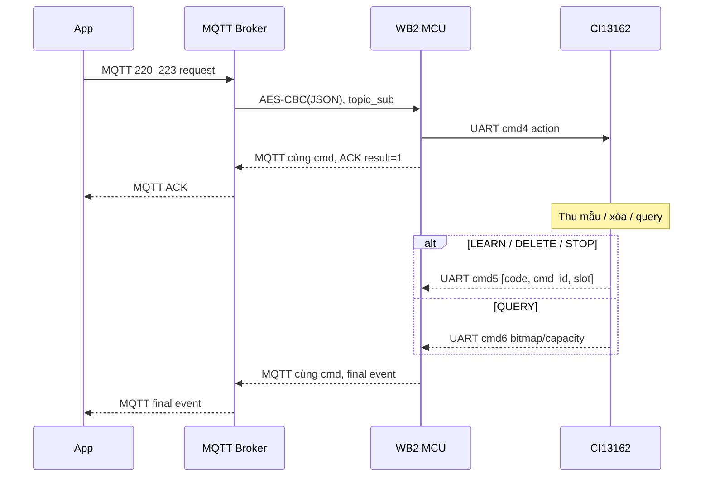

# Đặc tả CWSL qua MQTT

> Hợp đồng giao tiếp giữa App, firmware WB2 và chip giọng nói CI13162 cho chức năng học từ đánh thức và học cách nói mới cho lệnh quạt.
>
> **Trạng thái:** Đề xuất kỹ thuật — firmware WB2 hiện chưa triển khai CWSL UART `cmd` 4–6 hoặc MQTT 220–223.

## Mục lục

- [0. Phạm vi và nguồn sự thật](#0-phạm-vi-và-nguồn-sự-thật)
- [1. Xác minh ID 1–14](#1-xác-minh-id-114)
- [2. Phân biệt command ID, prompt ID và slot](#2-phân-biệt-command-id-prompt-id-và-slot)
- [3. Hiện trạng firmware và phần đề xuất](#3-hiện-trạng-firmware-và-phần-đề-xuất)
- [4. Kiến trúc tổng thể](#4-kiến-trúc-tổng-thể)
- [5. Quy ước MQTT hiện có](#5-quy-ước-mqtt-hiện-có)
- [6. Bảng lệnh MQTT CWSL](#6-bảng-lệnh-mqtt-cwsl)
- [7. Chú thích các trường MQTT](#7-chú-thích-các-trường-mqtt)
- [8. Mapping MQTT sang UART](#8-mapping-mqtt-sang-uart)
- [9. Chính sách cmd_id và slot](#9-chính-sách-cmd_id-và-slot)
- [10. FSM phía MCU](#10-fsm-phía-mcu)
- [11. Mã trạng thái](#11-mã-trạng-thái)
- [12. Ví dụ JSON end-to-end](#12-ví-dụ-json-end-to-end)
- [13. QoS 0, duplicate, timeout và reconnect](#13-qos-0-duplicate-timeout-và-reconnect)
- [14. Luồng UI đề xuất](#14-luồng-ui-đề-xuất)
- [15. Acceptance test](#15-acceptance-test)
- [16. Blocker firmware](#16-blocker-firmware)
- [17. Điều kiện mở ID 13 và 14](#17-điều-kiện-mở-id-13-và-14)
- [18. Quyết định sản phẩm còn mở](#18-quyết-định-sản-phẩm-còn-mở)

---

## 0. Phạm vi và nguồn sự thật

### 0.1. Phạm vi

Tài liệu này mô tả luồng:

```text
App
  → MQTT broker
  → WB2 MCU
  → UART0
  → CI13162
  → UART0
  → WB2 MCU
  → MQTT broker
  → App
```

Các thao tác được hỗ trợ:

- Học thêm một từ đánh thức.
- Học thêm một cách nói cho lệnh quạt có sẵn.
- Xóa một mẫu.
- Xóa mọi mẫu của một lệnh.
- Dừng phiên đang học.
- Query bitmap slot hoặc tổng dung lượng.

CWSL **chỉ thêm cách nói**, không tạo chức năng quạt mới. Ví dụ, mẫu học cho `cmd_id=7` vẫn chạy chức năng bật quạt của ID 7.

### 0.2. Thứ tự nguồn sự thật

| Ưu tiên | Nguồn | Phạm vi |
|---:|---|---|
| 1 | `[60000]{cmd_info_old}.xlsx`, hai sheet `<0>cmd` và `<1>wake` | ASR ID 1–14, wake/command, semantic ID, prompt playback ID |
| 2 | `commands.md` | Contract UART CWSL: `cmd` 4/5/6, action, slot, status và timeout chip |
| 3 | Firmware WB2 hiện tại | Envelope MQTT, topic, QoS, parser UART và hành vi quạt đang chạy |
| 4 | Tài liệu này | Contract MQTT 220–223 và FSM MCU đề xuất |

`cmd_CI13162_protocol.md` không được dùng làm contract CWSL vì tài liệu đó chỉ mô tả `cmd` 0–3 và còn khác với code hiện tại.

> **Lưu ý tên chip:** yêu cầu ban đầu ghi CI13126, trong khi code và OTA của repository dùng tên CI13162. Tên chip không xuất hiện trong payload MQTT, vì vậy khác biệt này không làm đổi contract MQTT.

---

## 1. Xác minh ID 1–14

Workbook hiện có hai sheet song song. Cả hai sheet đã dùng cùng ID cho các dòng 1–14.

| ID | Câu trong workbook | Semantic ID | `唤醒词` | `播报音0ID` | Loại thực tế | UART điều khiển quạt | MCU hiện tại | CWSL LEARN |
|---:|---|---:|:---:|---:|---|---|---|---|
| 1 | `XIN-CHÀO-HU-NÔ-NÍCH` | `0x0001` | YES | 1 | Wake factory và learned wake | Không map quạt | Đánh thức | **Cho phép**, slot 0–4 |
| 2 | `XIN-CHÀO-HU-NÔ-NÍT` | `0x0002` | YES | 2 | Wake factory | Không map quạt | Đánh thức | Cấm |
| 3 | `XIN-CHÀO-HU-NÔ-ÍCH` | `0x0003` | YES | 3 | Wake factory | Không map quạt | Đánh thức | Cấm |
| 4 | `HÂY-HU-NÔ-NÍCH` | `0x0004` | YES | 4 | Wake factory | Không map quạt | Đánh thức | Cấm |
| 5 | `HÂY-HU-NÔ-NÍT` | `0x0005` | YES | 5 | Wake factory | Không map quạt | Đánh thức | Cấm |
| 6 | `ÂY-HU-NÔ-NÍCH` | `0x0006` | YES | 6 | Wake factory | Không map quạt | Đánh thức | Cấm |
| 7 | `BẬT-QUẠT` | `0x0007` | NO | 7 | Command word | `{"cmd":1,"data":[1]}` | Có | **Cho phép** |
| 8 | `TẮT-QUẠT` | `0x0008` | NO | 8 | Command word | `{"cmd":1,"data":[0]}` | Có | **Cho phép** |
| 9 | `BẬT-SỐ-MỘT` | `0x0009` | NO | 9 | Command word | `{"cmd":2,"data":[1]}` | Có | **Cho phép** |
| 10 | `BẬT-SỐ-HAI` | `0x000A` | NO | 10 | Command word | `{"cmd":2,"data":[2]}` | Có | **Cho phép** |
| 11 | `BẬT-SỐ-BA` | `0x000B` | NO | 11 | Command word | `{"cmd":2,"data":[3]}` | Có | **Cho phép** |
| 12 | `CHẾ-ĐỘ-GIÓ-TỰ-NHIÊN` | `0x000D` | NO | 12 | Command word | `{"cmd":2,"data":[4]}` | Có | **Cho phép** |
| 13 | `BẬT-CHẾ-ĐỘ-QUAY` | `0x0010` | NO | 13 | Command word | `{"cmd":2,"data":[5]}` | `INVALID_DATA` | **Khóa** |
| 14 | `DỪNG-QUAY` | `0x0011` | NO | 14 | Command word | `{"cmd":2,"data":[6]}` | `INVALID_DATA` | **Khóa** |

### 1.1. Kết luận quan trọng

- ID **1–6 là wake word factory**.
- ID **7–14 là command word**, không phải prompt CWSL.
- Cột `播报音0ID` là ID âm thanh phát lại khi nhận diện. Việc giá trị cột này trùng command ID không biến ID 7–14 thành prompt CWSL.
- Learned wake của contract CWSL chỉ dùng `cmd_id=1` (`WAKE_UP_ID`), tối đa 5 slot.
- ID 13/14 có trong ASR workbook, nhưng firmware WB2 hiện chưa chấp nhận UART MODE 5/6.

### 1.2. Ghi chú workbook stale trong tài liệu cũ

`commands.md` hiện còn ghi `<1>wake` dùng ID 13 cho `CHẾ-ĐỘ-GIÓ-TỰ-NHIÊN`. Workbook trên disk đã được đồng nhất:

- ID 12: `CHẾ-ĐỘ-GIÓ-TỰ-NHIÊN`
- ID 13: `BẬT-CHẾ-ĐỘ-QUAY`
- ID 14: `DỪNG-QUAY`

Tài liệu cũ cần được cập nhật theo workbook.

---

## 2. Phân biệt command ID, prompt ID và slot

### 2.1. ASR command ID

`cmd_id` là ID nhận dạng trong bảng ASR. Mẫu CWSL học cho một `cmd_id` sẽ tái sử dụng hành vi có sẵn của ID đó.

Ví dụ:

```text
Câu mặc định BẬT-QUẠT → cmd_id=7 → bật quạt
Câu người dùng học cho cmd_id=7 → cmd_id=7 → vẫn bật quạt
```

### 2.2. Prompt playback ID

Cột `播报音0ID` trong workbook là ID file phát âm thanh phản hồi khi command được nhận diện.

Prompt sử dụng riêng trong quá trình CWSL là:

| Voice ID | Nội dung / trường hợp |
|---:|---|
| 211 | Học thành công |
| 212 | Bộ nhớ học đã đầy |
| 213 | Xóa thành công |
| 214 | Xóa thất bại |
| 217 | Đã kết thúc chế độ học |
| 218 | Học thất bại |
| 1007 | Chưa nghe rõ, nói lại |
| 1008 | Câu quá ngắn |
| 1009 | Trùng lệnh mặc định |
| 1010 | Mời nói câu lệnh điều khiển mới |
| 1020 | Mời nói từ đánh thức mới |
| 1021 | Không thể học từ đánh thức |

Các prompt trên không được dùng làm `cmd_id` MQTT.

### 2.3. Slot CWSL

Một mẫu được định danh bằng cặp:

```text
(cmd_id, slot)
```

Không coi slot là index vật lý toàn cục 0–19.

| Loại | `cmd_id` | Slot hợp lệ | Sức chứa |
|---|---|---|---:|
| Learned wake | 1 | 0–4 | 5 |
| Command | ID ASR | 0–14 | 15, pool chung |
| Tổng | — | — | 20 |

Hệ quả:

- Một `cmd_id` có thể có nhiều mẫu.
- `(7,0)` và `(8,0)` là hai mẫu khác nhau.
- 15 template command là một pool chung, không chia đều cho từng ID.
- `slot=255` là giá trị đặc biệt, không phải slot thật.

Ý nghĩa `255`:

| UART action | Ý nghĩa của `255` |
|---|---|
| LEARN | Tự chọn slot trống thấp nhất của `cmd_id` |
| DELETE với `cmd_id≠255` | Xóa mọi slot của `cmd_id` |
| DELETE `[2,255,255]` | Xóa toàn bộ wake + command |
| QUERY `cmd_id=255` | Query tổng dung lượng |

### 2.4. Overwrite

LEARN vào một slot đang có mẫu sẽ xóa mẫu cũ trước, sau đó mới thu mẫu mới. Nếu lần thu mới thất bại, mẫu cũ đã mất và không có rollback phía MCU.

---

## 3. Hiện trạng firmware và phần đề xuất

### 3.1. Hiện có — giữ nguyên

- MQTT subscribe trên một `topic_sub`, publish trên một `topic_pub`.
- Payload MQTT là AES-CBC128(JSON), không phải JSON plaintext trên wire.
- Subscribe QoS 0; publish QoS 0, retain 0.
- Key lệnh là `gs_dev_type[device_type]`, không phải key `cmd`.
- Branch/product này có thể dùng `fanoem`, `fandc`, `fanac` hoặc `fanacir` tùy `device_type`.
- MQTT handler lấy số lệnh trực tiếp từ value của key type, ví dụ `{"fanoem":20,...}`.
- Voice điều khiển quạt report bằng MQTT cmd 20 với `act_id=13` (`SRC_ACTION_VOICE`).
- UART0 dùng 115200 8N1, JSON ASCII kết thúc bằng CRLF.
- Parser UART WB2 hiện chỉ hỗ trợ `cmd` 0–3 và tối đa một phần tử `data`.
- MODE UART hiện chỉ nhận 1–4; 5/6 bị từ chối.
- `array_handler` chưa có lệnh MQTT CWSL.

Các vị trí code chính:

- MQTT dispatch: `smarthome_devices/components/application/process_data.c:88`
- MQTT/BLE task: `smarthome_devices/components/application/process_data.c:1358`
- Root command dispatch: `smarthome_devices/components/application/process_data.c:1400`
- MQTT QoS/topic: `smarthome_devices/components/middle/mqtt/m_mqtt_client_method.c:43`
- MQTT publish QoS/retain: `smarthome_devices/components/middle/mqtt/m_mqtt_client_method.c:138`
- MQTT output buffer 256: `smarthome_devices/components/middle/mqtt/m_mqtt_client_method.c:195`
- Device type strings: `smarthome_devices/components/hardware/hardware.c:9`
- UART enum/message hiện tại: `smarthome_devices/components/hardware/aiio_ci13162_uart.c:56`
- UART validate/parser hiện tại: `smarthome_devices/components/hardware/aiio_ci13162_uart.c:592`
- UART dispatch hiện tại: `smarthome_devices/components/hardware/aiio_ci13162_uart.c:1278`

### 3.2. Đề xuất mới

- MQTT cmd **220**: LEARN request, ACK tức thời và kết quả cuối.
- MQTT cmd **221**: DELETE request, ACK tức thời và kết quả cuối.
- MQTT cmd **222**: STOP request, ACK tức thời và kết quả cuối.
- MQTT cmd **223**: QUERY request, ACK tức thời và kết quả query.
- MQTT không dùng trường `action`; mã lệnh 220–223 trực tiếp xác định hành động.
- UART TX `cmd=4`; giá trị action UART vẫn là 1/2/4/6 theo contract chip.
- UART RX `cmd=5` và `cmd=6`.
- Parser `data[]` tối đa 4 phần tử byte, vẫn giữ ngoại lệ `cmd=3` version là `uint32`.
- FSM MCU giữ một mutating request và tối đa một QUERY.
- Tạm dừng version-query UART `cmd=3` trong lúc mutating CWSL.

---

## 4. Kiến trúc tổng thể



Hai lớp kết quả dùng cùng mã lệnh của hành động:

1. **ACK**: MCU đã chấp nhận và gửi UART; frame có `result`.
2. **Final event**: kết quả nghiệp vụ cuối từ chip hoặc timeout do MCU tạo; frame không có `result`.

Ví dụ LEARN dùng cmd 220 cho cả request, ACK và final event. `result=1` trên ACK **không** có nghĩa là học thành công.

---

## 5. Quy ước MQTT hiện có

| Thuộc tính | Giá trị |
|---|---|
| App → device | `topic_sub` |
| Device → app | `topic_pub` |
| Topic mẫu | `u/<uid>/<device_id>/<timestamp>` và `.../ok` |
| Subscribe QoS | 0 |
| Publish QoS | 0 |
| Retain | 0 |
| Keepalive | 10 giây |
| Payload wire | AES-CBC128(JSON) |
| JSON command key | `gs_dev_type[device_type]` |
| Nhánh này | thường là `fanoem` nếu device ID chứa `fanoem` |
| Output buffer MQTT | 256 byte |
| Giới hạn đề xuất plaintext 220–223 | dưới 180 byte |

Envelope phải là object phẳng. Mã lệnh trực tiếp xác định hành động, ví dụ LEARN:

```json
{"fanoem":220,"cmd_id":7,"slot":255,"u":55519,"act_id":0}
```

Không dùng các dạng sau:

```json
{"cmd":220,"data":[...]}
```

```json
{"fanoem":{"cmd":220}}
```

```json
{"fanoem":220,"action":1}
```

Không tạo topic riêng cho CWSL và không gửi trường `action` trong payload MQTT.

---

## 6. Bảng lệnh MQTT CWSL

### 6.1. Bảng tổng hợp

| MQTT | Tên | Request App → thiết bị | UART MCU → chip | ACK / final event thiết bị → App |
|---:|---|---|---|---|
| 220 | LEARN | `u, act_id, cmd_id, slot` | `cmd4 [1,cmd_id,slot]` | ACK 220; sau đó final 220 từ `cmd5` |
| 221 | DELETE | `u, act_id, cmd_id, slot` | `cmd4 [2,cmd_id,slot]` | ACK 221; sau đó final 221 từ `cmd5` |
| 222 | STOP | `u, act_id` | `cmd4 [4]` | ACK 222; sau đó final 222 từ `cmd5` nếu đã gửi UART |
| 223 | QUERY | `u, act_id, cmd_id` | `cmd4 [6,cmd_id]` | ACK 223; sau đó final 223 từ `cmd6` |

Mã lệnh MQTT thay cho trường `action`:

| MQTT cmd | UART action | Hành động |
|---:|---:|---|
| 220 | 1 | LEARN |
| 221 | 2 | DELETE |
| 222 | 4 | STOP |
| 223 | 6 | QUERY |

### 6.2. Quy tắc request

Bắt buộc chung:

```text
<device_type> thuộc 220..223
u
act_id
```

Theo mã lệnh:

| MQTT cmd | Field bắt buộc thêm | Field bỏ qua |
|---:|---|---|
| 220 LEARN | `cmd_id`, `slot` | — |
| 221 DELETE | `cmd_id`, `slot` | — |
| 222 STOP | Không | `cmd_id`, `slot` nếu App gửi nhầm |
| 223 QUERY | `cmd_id` | `slot` nếu App gửi nhầm |

Trường `action` không hợp lệ trong request CWSL mới; firmware không dùng trường này để chọn hành động.

### 6.3. Quy tắc ACK

ACK thành công cho LEARN:

```json
{
  "fanoem": 220,
  "cmd_id": 7,
  "slot": 255,
  "u": 55519,
  "act_id": 0,
  "result": 1
}
```

- ACK dùng cùng mã lệnh với request.
- `result=1`: UART TX thành công; không có `code`.
- `result=0`: request bị từ chối local; bắt buộc có `code`; không có final event nếu chưa gửi UART.

### 6.4. Quy tắc final event

LEARN final event:

```json
{
  "fanoem": 220,
  "cmd_id": 7,
  "slot": 0,
  "code": 32,
  "u": 55519,
  "act_id": 0
}
```

Quy tắc:

- Final event dùng cùng mã lệnh với request và không bao giờ có `result`.
- LEARN_OK phải trả slot thật được gán, không giữ `255`.
- `cmd_id`, `slot`, `code` của final event mutating lấy từ frame chip.
- `u`, `act_id` lấy từ request đang pending; sau khi STOP được chấp nhận thì final cmd 222 echo `u`, `act_id` của request STOP.
- QUERY thành công không có `code`.
- QUERY timeout có `code=52` và không có bitmap/capacity.

---

## 7. Chú thích các trường MQTT

Tất cả số là JSON Number nguyên, biểu diễn ở hệ thập phân.

| Trường | Có mặt | Kiểu / miền | Nguồn | Ý nghĩa |
|---|---|---|---|---|
| `<device_type>` | Mọi frame | 220, 221, 222 hoặc 223 | Hiện có | Ví dụ `fanoem`; value trực tiếp xác định LEARN/DELETE/STOP/QUERY |
| `u` | Request; echo ACK/final event | `uint32`, không âm | Hiện có | User ID; không phải request ID |
| `act_id` | Request; echo ACK/final event | `uint8`, thường App = 0 | Hiện có | Nguồn thao tác; không đảm bảo duy nhất |
| `action` | Không được gửi | — | — | Hành động được xác định bằng MQTT cmd 220–223 |
| `cmd_id` | LEARN/DELETE/QUERY; final event | `uint8` | Mới | ASR command ID; 255 là giá trị đặc biệt |
| `slot` | LEARN/DELETE; mutating final event | Wake 0–4, command 0–14, hoặc 255 | Mới | Địa chỉ mẫu hoặc `CWSL_ANY` |
| `result` | Chỉ ACK | 0 hoặc 1 | Hiện có | 1 = request đã được gửi UART; 0 = bị từ chối local |
| `code` | ACK fail hoặc final event fail/status | Byte status hoặc mã local | Mới | Trạng thái chi tiết |
| `bitmap` | QUERY cmd 223 thành công | `uint16` | Mới | `low | (high << 8)`; bit N tương ứng slot N |
| `wake` | QUERY capacity cmd 223 | 0–5 | Mới | Số template wake đang dùng |
| `ncmd` | QUERY capacity cmd 223 | 0–15 | Mới | Số template command đang dùng |
| `nfree` | QUERY capacity cmd 223 | 0–20 | Mới | Tổng slot còn trống; ví dụ chip dùng `20-wake-ncmd` |
| `request_id` | Không dùng | — | — | Không thêm vì protocol hiện tại không có |
| `id` | Không dùng cho CWSL | String | Hiện có | Chỉ là device identity trong cmd 100/105 |
| `data` | Không dùng cho CWSL MQTT | — | Hiện có | Đang dành cho cmd 990, không dùng để nhét mảng UART |

### 7.1. Validation

Validation phải thực hiện trước khi cast về `uint8_t`.

Trả ACK cùng mã lệnh với `result=0, code=64` nếu:

- Thiếu field bắt buộc.
- Field cần là Number nhưng nhận String/Object/Array.
- Số âm.
- Số không nguyên.
- `cmd_id`, `slot` hoặc `act_id` lớn hơn 255.
- Payload có trường `action` của contract cũ.
- DELETE cmd 221 dùng `cmd_id=255` nhưng `slot≠255`.
- LEARN/DELETE ID bị khóa theo policy sản phẩm.

---

## 8. Mapping MQTT sang UART

UART frame:

```text
{"cmd":<id>,"data":[...]}\r\n
```

| MQTT cmd | UART action | UART MCU → chip | UART chip → MCU | MQTT final event |
|---:|---:|---|---|---|
| 220 LEARN | 1 | `{"cmd":4,"data":[1,<cmd_id>,<slot>]}` | `{"cmd":5,"data":[<code>,<cmd_id>,<slot>]}` | cmd 220 với `cmd_id,slot,code` |
| 221 DELETE | 2 | `{"cmd":4,"data":[2,<cmd_id>,<slot>]}` | `cmd5 [code,id,slot]` | cmd 221 với `cmd_id,slot,code` |
| 222 STOP | 4 | `{"cmd":4,"data":[4]}` | `cmd5 [code,id,slot]` | cmd 222 với `cmd_id,slot,code` |
| 223 QUERY ID | 6 | `{"cmd":4,"data":[6,<cmd_id>]}` | `{"cmd":6,"data":[id,low,high]}` | cmd 223 với `bitmap=low|(high<<8)` |
| 223 QUERY capacity | 6 | `{"cmd":4,"data":[6,255]}` | `{"cmd":6,"data":[255,wake,ncmd,nfree]}` | cmd 223 với `wake,ncmd,nfree` |

### 8.1. Quy tắc bắt buộc

- STOP UART luôn là `data=[4]`; không thêm `cmd_id` hoặc `slot` vào frame STOP.
- QUERY request luôn dùng UART `cmd=4`; `cmd=6` chỉ là response từ chip.
- QUERY không sinh `cmd=5`.
- LEARN/DELETE/STOP sinh đúng một `cmd=5` cuối.
- Sau kết quả cuối không gửi STOP thêm. STOP chỉ dùng để hủy phiên đang chạy.

---

## 9. Chính sách `cmd_id` và slot

### 9.1. Allow-list

| `cmd_id` | LEARN | DELETE | QUERY | Ghi chú |
|---:|---|---|---|---|
| 1 | Cho phép | Cho phép | Cho phép | Learned wake, slot 0–4 hoặc 255 |
| 2–6 | Cấm policy | Cấm policy | Cho phép | Wake factory có thật trong ASR |
| 7–12 | Cho phép | Cho phép | Cho phép | Đã map hành vi quạt |
| 13–14 | Cấm policy | Cấm policy | Cho phép | Có trong ASR, nhưng MCU chưa xử lý MODE 5/6 |
| 255 | Cấm LEARN | Chỉ `[2,255,255]` | Capacity | Giá trị đặc biệt |
| 0, 99, ID khác | Cấm | Cấm | Cấm | Không có trong bảng ASR |

Mã từ chối:

- ID 2–6 hoặc 13–14: `code=64` vì đây là policy sản phẩm, không phải ID không tồn tại.
- ID 0/99/khác không có trong ASR: `code=65`.
- LEARN `cmd_id=255`: `code=65`.

### 9.2. Slot hợp lệ

| Loại | Slot hợp lệ |
|---|---|
| `cmd_id=1` | 0–4 hoặc 255 |
| `cmd_id=7..12` | 0–14 hoặc 255 |
| DELETE all | Chỉ `cmd_id=255, slot=255` |

Sai slot trả `code=66`.

### 9.3. QUERY

QUERY được phép cho mọi ASR ID 1–14 và 255 vì đây là thao tác đọc thuần. Việc ID 13/14 chưa được MCU map MODE 5/6 không phải lý do chặn QUERY.

---

## 10. FSM phía MCU

### 10.1. State

| State | Pending | Request được phép | Timeout |
|---|---|---|---|
| `CWSL_MCU_IDLE` | Không | LEARN/DELETE/QUERY hợp lệ; STOP trả code 68 | Không |
| `CWSL_MCU_WAIT_STATUS` | 1 mutating, chờ cmd5 | STOP; một QUERY; LEARN/DELETE khác trả 67 | Watchdog mutating tạm thời 120 giây |
| `CWSL_MCU_WAIT_INFO` | 1 QUERY, chờ cmd6 | Request CWSL khác trả 67 | 2 giây |
| `CWSL_MCU_WAIT_BOTH` | 1 mutating + 1 QUERY | STOP; QUERY thứ hai và mutating khác trả 67 | Hai timer độc lập |
| `CWSL_MCU_OTA` | Không CWSL | Mọi cmd 220–223 trả code 69 | Đến khi release UART OTA |

### 10.2. Chuyển trạng thái chính

```text
IDLE + LEARN cmd 220 / DELETE cmd 221
  → validate
  → TX UART cmd4
  → ACK cùng cmd result=1
  → WAIT_STATUS

IDLE + QUERY cmd 223
  → TX UART cmd4 action=6
  → ACK 223 result=1
  → WAIT_INFO

WAIT_STATUS + QUERY cmd 223
  → TX query
  → ACK 223 result=1
  → WAIT_BOTH

WAIT_STATUS/WAIT_BOTH + STOP cmd 222
  → TX UART [4]
  → ACK 222 result=1
  → lưu u/act_id của STOP
  → tiếp tục chờ cmd5 cuối; publish final cmd 222
```

### 10.3. Query song song với LEARN

Contract chip cho phép QUERY trong mọi trạng thái, kể cả khi đang học. MCU cho phép tối đa một QUERY song song với một mutating request.

Hai response độc lập:

- Final event cmd 223 không kết thúc spinner LEARN.
- Final event cmd 220/221/222 mới kết thúc phiên LEARN/DELETE/STOP tương ứng.

QUERY thứ hai khi đã có QUERY pending trả ACK 223 `result=0, code=67`.

### 10.4. Khớp cmd5

Không được so sánh cứng với `pending.slot` khi slot request là 255.

Đối với LEARN cmd 220 hoặc DELETE cmd 221, khớp nếu:

1. Có một mutating pending.
2. `cmd_id` response bằng `pending.cmd_id`.
3. `pending.slot==255` hoặc `response.slot==pending.slot`.

Đối với STOP cmd 222, frame cmd5 đầu tiên sau khi STOP được gửi sẽ kết thúc mutating pending hiện tại. Không khớp theo `cmd_id`/`slot` của request STOP vì STOP không mang hai field này.

Lý do LEARN cần wildcard slot: request gửi slot 255 nhưng chip trả slot thật, ví dụ:

```text
Request [1,7,255]
Response [32,7,0]
```

### 10.5. Xác định mã lệnh cho final event

| Trường hợp | MQTT cmd final event |
|---|---:|
| `0x20` LEARN_OK khi LEARN pending | 220 |
| `0x21` DELETE_OK khi DELETE pending | 221 |
| `0x22` EXIT_OK sau khi STOP đã được gửi | 222 |
| Nibble 3/4 | Mã lệnh mutating đang pending; nếu STOP đã được gửi thì dùng 222 |
| Timeout do MCU | Mã lệnh đang pending; nếu STOP đã được gửi thì dùng 222; QUERY timeout dùng 223 |

### 10.6. STOP race

Frame cmd5 đầu tiên khớp pending được coi là kết quả cuối và clear pending. Frame tới muộn sau khi pending đã clear bị bỏ, không tạo final event thứ hai.

Do protocol không có `request_id`, nhiều App/điện thoại cùng thao tác có giới hạn correlation. Mặc định an toàn:

- Mỗi thiết bị chỉ có một mutating request.
- App nào nhận BUSY không được gửi LEARN đè.
- Nếu không chắc kết quả, dùng QUERY để reconcile.

### 10.7. UART command khác trong lúc CWSL

Chỉ drop cmd5/cmd6 không khớp hoặc tới muộn. UART cmd1/cmd2/cmd3 vẫn phải được xử lý theo hành vi hiện tại khi có thể xuất hiện.

Version query cmd3 từ MCU nên tạm dừng trong lúc mutating CWSL để tránh xen frame vào phiên học. Response cmd3 đã tới vẫn được cache.

---

## 11. Mã trạng thái

### 11.1. ACK local của cmd 220–223 (`result=0`)

| Dec | Hex | Tên | Ý nghĩa | App xử lý |
|---:|---:|---|---|---|
| 64 | `0x40` | `BAD_REQUEST` | Payload sai hoặc policy chặn ID hợp lệ trong ASR | Sửa payload / không hiện chức năng bị khóa |
| 65 | `0x41` | `BAD_COMMAND_ID` | ID không có trong ASR; LEARN ID 255 | Không gửi ID đó |
| 66 | `0x42` | `BAD_SLOT` | Slot vượt trần loại | Sửa slot |
| 67 | `0x43` | `BUSY` | Đang có pending CWSL | Đợi hoặc QUERY, không LEARN đè |
| 68 | `0x44` | `NOT_IN_LEARN_MODE` | STOP khi IDLE | Đóng UI, không coi là lỗi nặng |
| 69 | — | `OTA_HOLD` | UART/thiết bị đang OTA | Chờ OTA xong, QUERY lại |
| 70 | — | `TX_FAIL` | UART chưa sẵn sàng hoặc gửi UART thất bại | Retry một lần nếu chắc chắn IDLE |

Mã 69/70 là mã local mới của MQTT, không phải `cwsl_status_t` từ chip.

### 11.2. Final event cmd 220/221/222 từ UART `cmd5`

| Dec | Hex | Tên | Lớp | Prompt | Ý nghĩa UI |
|---:|---:|---|---:|---:|---|
| 32 | `0x20` | `LEARN_OK` | OK | 211 | Học thành công; hiển thị slot |
| 33 | `0x21` | `DELETE_OK` | OK | 213 | Xóa thành công |
| 34 | `0x22` | `EXIT_OK` | OK | 217 | Đã dừng phiên học |
| 48 | `0x30` | `LEARN_FAIL` | Fail | 218/1021 | Học thất bại; overwrite có thể làm mất mẫu cũ |
| 49 | `0x31` | `LEARN_ABORTED` | Fail | — | SDK abort |
| 50 | `0x32` | `NO_SLOT` | Fail | 212 | Bộ nhớ đầy |
| 51 | `0x33` | `DELETE_FAIL` | Fail | 214 | Không xóa được |
| 52 | `0x34` | `TIMEOUT` | Fail | — | Chip timeout hoặc watchdog MCU |
| 64 | `0x40` | `BAD_REQUEST` | Reject | — | Hiếm, nếu MCU đã gửi request sai xuống chip |
| 65 | `0x41` | `BAD_COMMAND_ID` | Reject | — | Chip không nhận ID |
| 66 | `0x42` | `BAD_SLOT` | Reject | — | Chip không nhận slot |
| 67 | `0x43` | `BUSY` | Reject | — | Chip bận sau khi MCU đã gửi |
| 68 | `0x44` | `NOT_IN_LEARN_MODE` | Reject | — | STOP khi chip không học |

Quy tắc:

- `code >> 4 == 2`: kết thúc thành công.
- `code >> 4 == 3`: kết thúc thất bại.
- `code >> 4 == 4`: request bị từ chối.
- LEARN chỉ thành công với 32.
- DELETE chỉ thành công với 33.
- STOP chỉ thành công với 34.

---

## 12. Ví dụ JSON end-to-end

Tất cả JSON dưới đây là plaintext trước mã hóa AES.

### 12.1. Query tổng dung lượng

App gửi:

```json
{"fanoem":223,"cmd_id":255,"u":55519,"act_id":0}
```

MCU gửi ACK:

```json
{"fanoem":223,"cmd_id":255,"u":55519,"act_id":0,"result":1}
```

UART MCU → chip:

```text
{"cmd":4,"data":[6,255]}\r\n
```

UART chip → MCU:

```text
{"cmd":6,"data":[255,2,6,12]}\r\n
```

MCU publish:

```json
{"fanoem":223,"cmd_id":255,"wake":2,"ncmd":6,"nfree":12,"u":55519,"act_id":0}
```

### 12.2. Query bitmap ID 7

App:

```json
{"fanoem":223,"cmd_id":7,"u":55519,"act_id":0}
```

UART:

```text
MCU  → chip: {"cmd":4,"data":[6,7]}
chip → MCU:  {"cmd":6,"data":[7,5,0]}
```

MQTT final event cmd 223:

```json
{"fanoem":223,"cmd_id":7,"bitmap":5,"u":55519,"act_id":0}
```

`bitmap=5` tương đương `0x0005`: slot 0 và 2 đang có mẫu.

### 12.3. Learn command ID 7, auto-slot

App:

```json
{"fanoem":220,"cmd_id":7,"slot":255,"u":55519,"act_id":0}
```

UART:

```text
{"cmd":4,"data":[1,7,255]}\r\n
```

ACK:

```json
{"fanoem":220,"cmd_id":7,"slot":255,"u":55519,"act_id":0,"result":1}
```

Chip phát prompt 1010, người dùng nói, sau đó chip trả:

```text
{"cmd":5,"data":[32,7,0]}\r\n
```

Event:

```json
{"fanoem":220,"cmd_id":7,"slot":0,"code":32,"u":55519,"act_id":0}
```

Khi người dùng nói lại câu đã học, thiết bị report trạng thái quạt bằng MQTT cmd 20, `act_id=13`; không phát lại final event CWSL.

### 12.4. Learn wake

```json
{"fanoem":220,"cmd_id":1,"slot":255,"u":55519,"act_id":0}
```

UART:

```text
{"cmd":4,"data":[1,1,255]}\r\n
```

LEARN_OK phải trả slot 0–4.

### 12.5. Delete một slot

```json
{"fanoem":221,"cmd_id":7,"slot":0,"u":55519,"act_id":0}
```

UART:

```text
{"cmd":4,"data":[2,7,0]}\r\n
```

Kết quả thành công:

```json
{"fanoem":221,"cmd_id":7,"slot":0,"code":33,"u":55519,"act_id":0}
```

### 12.6. Delete mọi slot của ID 7

```json
{"fanoem":221,"cmd_id":7,"slot":255,"u":55519,"act_id":0}
```

UART:

```text
{"cmd":4,"data":[2,7,255]}\r\n
```

### 12.7. Delete all

Chỉ dùng cho flow unbind/factory reset nếu product quyết định bật:

```json
{"fanoem":221,"cmd_id":255,"slot":255,"u":55519,"act_id":0}
```

UART:

```text
{"cmd":4,"data":[2,255,255]}\r\n
```

Không nên đưa thao tác này thành nút thông thường trong App.

### 12.8. Stop phiên học

App:

```json
{"fanoem":222,"u":55519,"act_id":0}
```

UART phải là:

```text
{"cmd":4,"data":[4]}\r\n
```

Chip trả địa chỉ phiên bị hủy:

```text
{"cmd":5,"data":[34,7,0]}\r\n
```

MQTT:

```json
{"fanoem":222,"cmd_id":7,"slot":0,"code":34,"u":55519,"act_id":0}
```

### 12.9. Busy

Request thứ hai trong lúc đã có mutating pending:

```json
{"fanoem":220,"cmd_id":8,"slot":255,"u":55519,"act_id":0,"result":0,"code":67}
```

Không gửi UART thứ hai.

### 12.10. ID bị khóa hoặc sai

| Input | MQTT cmd ACK | Nội dung ACK |
|---|---:|---|
| LEARN ID 13 | 220 | `result=0, code=64` |
| LEARN ID 2 | 220 | `result=0, code=64` |
| LEARN ID 99 | 220 | `result=0, code=65` |
| LEARN ID 7 slot 15 | 220 | `result=0, code=66` |
| LEARN ID 1 slot 5 | 220 | `result=0, code=66` |
| STOP khi IDLE | 222 | `result=0, code=68` |
| OTA đang chạy | Cùng cmd request | `result=0, code=69` |
| UART TX fail | Cùng cmd request | `result=0, code=70` |

### 12.11. Query trong lúc học

```text
LEARN cmd 220 cho ID 7 đang WAIT_STATUS
App gửi QUERY cmd 223 cho ID 7
MCU ACK 223 result=1
MCU chuyển WAIT_BOTH
Final 223 bitmap có thể tới trước
Final 220 LEARN_OK tới sau
```

Final event cmd 223 không được tắt spinner LEARN.

---

## 13. QoS 0, duplicate, timeout và reconnect

### 13.1. QoS 0

Vì QoS 0 và không retain:

- Request cmd 220–223 có thể mất.
- ACK có thể mất dù UART đã được gửi.
- Final event có thể mất dù thao tác đã hoàn tất.
- MCU không queue/replay final event sau reconnect.

Không được suy luận “không thấy ACK trong 3 giây = firmware cũ”. ACK có thể mất trong khi chip đang học thật.

### 13.2. Probe firmware hỗ trợ CWSL

Nếu LEARN cmd 220 im lặng:

1. Không gửi LEARN lại.
2. Gửi QUERY capacity cmd 223 với `cmd_id=255`.
3. Nếu QUERY cũng hoàn toàn im lặng, firmware có thể chưa hỗ trợ nhóm cmd 220–223.
4. Nếu QUERY có ACK/final event, firmware hỗ trợ CWSL; tiếp tục reconcile bằng QUERY.

### 13.3. Correlation và idempotency

Protocol hiện tại không có `request_id`. `u` là user ID; `act_id` là nguồn thao tác, không đảm bảo duy nhất.

Do đó:

- Chỉ cho phép một mutating request trên thiết bị.
- Cho phép tối đa một QUERY song song.
- App không tự retry LEARN/DELETE khi kết quả không chắc chắn.
- Khi mất ACK/final event, App phải QUERY thay vì gửi lại mutation.
- Nếu mutation đầu đã hoàn tất nhưng final event mất, gửi lại mutation khi MCU đã IDLE có thể thực thi lần hai; protocol không cung cấp exactly-once.

### 13.4. Timeout chip và MCU

Chip có idle timeout 30 giây **không có tiến triển**. Bộ đếm có thể được gia hạn sau khi bắt đầu đăng ký mẫu hoặc sau mỗi lần thu. Prompt 1007/1008/1009 không tạo frame UART tiến trình.

Vì vậy watchdog MCU 32 giây là quá ngắn. Đề xuất ban đầu:

| Chờ | Timeout MCU đề xuất | Hành vi |
|---|---:|---|
| cmd5 mutating | 120 giây, cần đo lại trên chip thật | Publish final event cmd 220/221/222 tương ứng với `code=52`, clear pending |
| cmd6 QUERY | 2 giây, cần đo lại | Publish final event cmd 223 với `code=52`; không abort mutating |

120 giây là giá trị tạm thời để tránh cắt nhầm phiên có nhiều lần nói lại. Cần đo số lần thu tối đa của CI13162 trước khi khóa production.

### 13.5. App timeout

Sau khoảng 35 giây chưa có final event cmd 220, App không được gửi LEARN lại. App gửi QUERY cmd 223:

- Nếu thấy slot mới bật: coi kết quả đã được lưu.
- Nếu chưa thấy slot: tiếp tục chờ hoặc báo chưa xác định theo UX.
- Nếu đây là overwrite và bit bị tắt sau fail: cảnh báo mẫu cũ đã mất.

### 13.6. Late response

- cmd5 đến sau watchdog MCU: drop, không tạo final event thứ hai.
- cmd6 đến sau timeout QUERY: drop.
- Reboot giữa LEARN: pending RAM mất, không có final event; App phải QUERY sau reconnect.

### 13.7. Reconnect

Khi mở lại màn CWSL hoặc sau reconnect:

1. Gửi cmd 223 QUERY `cmd_id=255`.
2. Gửi cmd 223 QUERY từng ID `1,7,8,9,10,11,12`.
3. Vẽ lại bitmap slot.
4. Không tự động LEARN lại request cũ.
5. Sau voice OTA cmd 134, QUERY lại toàn bộ vì vùng template có thể bị ảnh hưởng tùy OTA.

---

## 14. Luồng UI đề xuất

Chỉ hiển thị chức năng học cho:

- `cmd_id=1`: “Từ đánh thức Hunonic”
- `cmd_id=7`: “Bật quạt”
- `cmd_id=8`: “Tắt quạt”
- `cmd_id=9`: “Số 1”
- `cmd_id=10`: “Số 2”
- `cmd_id=11`: “Số 3”
- `cmd_id=12`: “Gió tự nhiên”

Không hiển thị nút học cho ID 2–6 và 13–14.

| Sự kiện | Hành vi UI |
|---|---|
| Vào màn | Gửi QUERY cmd 223 cho capacity và từng ID được hỗ trợ |
| Nhấn Học | Gửi LEARN cmd 220, thường dùng slot 255 |
| ACK 220 `result=1` | Hiển thị “Mời nói sau tiếng loa”; bật spinner |
| Final 220 `code=32` | Tắt spinner, hiển thị slot được gán |
| Final 222 `code=34` | Tắt spinner, hiển thị đã hủy |
| Final 223 | Chỉ cập nhật bitmap/capacity, không tắt spinner LEARN |
| 35 giây chưa có final event | Gửi QUERY cmd 223 để reconcile; không LEARN lại |
| code=48 | Báo học thất bại; nếu overwrite, cảnh báo mẫu cũ có thể mất |
| code=50 | Báo bộ nhớ đầy |
| code=67 | Báo đang có phiên khác; không spam request |
| code=68 | Đóng UI STOP nhẹ nhàng, không hiện lỗi nghiêm trọng |
| code=69 | Báo thiết bị đang cập nhật firmware |
| `nfree=0` | Disable học mẫu mới; vẫn cho DELETE hoặc overwrite có cảnh báo |

---

## 15. Acceptance test

### 15.1. Parser và UART

1. Parse OK:
   - `{"cmd":5,"data":[32,7,0]}`
   - `{"cmd":6,"data":[7,5,0]}`
   - `{"cmd":6,"data":[255,2,6,12]}`
2. Reject cmd5 thiếu phần tử.
3. Reject unknown cmd.
4. Assembler xử lý được hai frame CRLF liền nhau.
5. Stream overflow không dispatch nửa frame.
6. MODE 1–4 vẫn OK; 5/6 vẫn reject cho đến khi mở ID 13/14.

### 15.2. MQTT và nghiệp vụ

| # | Test | Kỳ vọng |
|---:|---|---|
| 1 | QUERY capacity cmd 223 | ACK 223=1, sau đó final 223 `wake/ncmd/nfree` |
| 2 | LEARN cmd 220, ID 7 slot 255 | ACK=1, UART `[1,7,255]`, final 220 code=32 với slot thật |
| 3 | Nói lại câu học | MQTT cmd 20, `act_id=13`, không phát lại final CWSL |
| 4 | QUERY cmd 223, ID 7 | Bit slot mới bật |
| 5 | LEARN thêm cùng ID 7 | Slot khác; cả hai câu điều khiển được |
| 6 | DELETE cmd 221 một slot | code=33; slot khác giữ nguyên |
| 7 | LEARN cmd 220 wake ID 1 | Slot 0–4; wake factory vẫn hoạt động |
| 8 | LEARN thứ hai khi đang học | ACK 220 code=67; không UART thứ hai |
| 9 | QUERY khi đang học | Final 223 không kết thúc LEARN |
| 10 | STOP cmd 222 khi đang học | UART `[4]`, final 222 code=34 |
| 11 | STOP cmd 222 khi IDLE | ACK 222 code=68, không final event |
| 12 | Chip timeout | Final của cmd pending có code=52 |
| 13 | Pool đầy | Final 220 code=50 |
| 14 | Overwrite rồi học fail | Final 220 code=48; mẫu cũ không còn |
| 15 | LEARN 2–6/13–14 | ACK 220 code=64, không UART |
| 16 | LEARN ID 99 | ACK 220 code=65 |
| 17 | Slot ngoài trần | ACK của cmd tương ứng code=66 |
| 18 | Thiếu field | ACK của cmd tương ứng code=64 |
| 19 | OTA đang chạy | ACK của cmd tương ứng code=69 |
| 20 | UART TX fail | ACK của cmd tương ứng code=70 |
| 21 | Sai root key hoặc firmware cũ | Không ACK |
| 22 | Payload cmd 220–223 | Plaintext dưới 180 byte; frame encrypted không vượt output buffer |

### 15.3. Bốn gate bắt buộc

1. **Mất ACK QoS 0**
   - UART đã thực hiện LEARN cmd 220.
   - App probe bằng QUERY cmd 223.
   - App không gửi LEARN đè.

2. **QUERY trong lúc LEARN**
   - Final 223 có thể tới trước final 220.
   - Spinner không tắt vì query event.

3. **Late cmd5**
   - Watchdog MCU tạo final event cmd 220/221/222 đang pending với code=52.
   - cmd5 tới muộn bị drop.
   - App QUERY thấy bit thì reconcile thành công.

4. **STOP race**
   - Chỉ một final event đầu tiên được sử dụng.
   - Frame muộn bị drop.
   - App khác không gửi LEARN đè.

---

## 16. Blocker firmware

Firmware WB2 hiện chưa thể chạy contract này.

| Blocker | Hiện trạng | Cần làm |
|---|---|---|
| Parser data | Struct chỉ có một `uint32_t data` | Thêm `data_count` và `uint8_t data[4]`; giữ version riêng |
| Enum UART | Chỉ cmd 0–3 | Thêm CWSL=4, STATUS=5, INFO=6 |
| Parser cmd5/6 | Multi-data bị `INVALID_FORMAT` | Parse tối đa 4 byte và validate theo cmd |
| TX cmd4 | Chưa có | Thêm helper format JSON + CRLF |
| FSM pending | Chưa có | Một mutating + một QUERY |
| UART process | Chỉ reset/turn/mode/version | Xử lý cmd5/cmd6 và publish final event cmd 220–223 |
| MQTT handler | Chưa có cmd 220–223 | Thêm bốn handler `{app_cwsl_learn,220}`, `{app_cwsl_delete,221}`, `{app_cwsl_stop,222}`, `{app_cwsl_query,223}` vào `array_handler` |
| MQTT final event | Chưa có | Dùng lại cmd request tương ứng; không đăng ký handler TX-only riêng |
| Version query | Có thể xen trong phiên | Pause TX cmd3 khi mutating pending |
| OTA | Có thể chiếm/reset UART | Gate cmd 220–223; reject cmd 129/134 khi đang pending trước reset |
| Timeout | Chưa có | Watchdog mutating và query độc lập |

Không cần tạo task UART mới nếu tiếp tục xử lý trong `app_handler_msg_task` và `aiio_ci13162_uart_process()`.

### 16.1. Rủi ro code hiện tại

- UART command queue chỉ dài 4; frame status có thể bị drop khi burst.
- MQTT/BLE pqueue chỉ dài 4, send timeout 0.
- MQTT publish QoS 0, không retry.
- `respond[512]` là buffer dùng chung; cần tránh race khi nhiều task publish.
- `out_buffer_size=256`; payload phải giữ ngắn.
- OTA acquire reset UART command queue và stream.
- Nếu mất cmd5, App chỉ có thể reconcile bằng timeout + QUERY.

---

## 17. Điều kiện mở ID 13 và 14

ID 13/14 đã có trong workbook nhưng bị khóa cho LEARN/DELETE vì WB2 hiện chỉ nhận MODE 1–4.

Chỉ mở khi đủ tất cả điều kiện:

1. UART validate nhận `cmd=2, data=[5]` và `[6]`.
2. UART dispatch gọi:
   - `m_fan_set_swing(1)` cho ID 13 / MODE 5.
   - `m_fan_set_swing(0)` cho ID 14 / MODE 6.
3. MQTT cmd 20 report trạng thái swing đúng sau voice command.
4. Đo trên chip thật xác nhận ASR ID 13/14 phát UART MODE 5/6.
5. Đo lại cả câu factory và câu học CWSL.
6. Product xác nhận quay bằng giọng nằm trong scope.

Sau khi mở:

- Allow-list LEARN/DELETE chuyển từ `{1,7..12}` thành `{1,7..14}`.
- QUERY không cần thay đổi vì đã cho phép 13/14.
- `commands.md` bổ sung mapping ID 13/14 vào bảng ASR → MCU.
- Không đổi ý nghĩa code 65.

---

## 18. Quyết định sản phẩm còn mở

Nếu không có quyết định khác, dùng default sau:

| Câu hỏi | Default đề xuất |
|---|---|
| Unbind cmd 123 có xóa template chip không? | Gửi DELETE all cmd 221 best-effort, nhưng không cam kết do reset/time limit |
| Có thêm capability `"cwsl":1` vào cmd 100/105 không? | Chưa thêm; App probe bằng QUERY cmd 223 với `cmd_id=255` |
| Watchdog mutating bao lâu? | Tạm 120 giây; đo chip thật trước production |
| App có nút DELETE all không? | Không; chỉ dùng trong unbind/factory reset |
| CWSL qua BLE có là scope riêng không? | Không; `app_send_data` có thể mirror cùng JSON, không tạo protocol khác |
| Khi nào mở 13/14? | Chỉ khi đủ các điều kiện ở mục 17 |

---

## Phụ lục A. Tóm tắt contract tối thiểu

```text
MQTT cmd:
  220 = LEARN request / ACK / final event
  221 = DELETE request / ACK / final event
  222 = STOP request / ACK / final event
  223 = QUERY request / ACK / final event

Không dùng trường action trong MQTT.
UART action tương ứng vẫn là 1 / 2 / 4 / 6.

UART:
  MCU → chip cmd4
  chip → MCU cmd5 status
  chip → MCU cmd6 query info

CWSL product allow-list:
  LEARN/DELETE = 1, 7..12
  QUERY        = 1..14, 255

Slot:
  wake         = 0..4 hoặc 255
  command      = 0..14 hoặc 255
  delete all   = cmd_id=255, slot=255

Hai lớp kết quả dùng cùng MQTT cmd của request:
  ACK có result=1 = UART đã gửi
  Final event không có result; code = kết quả cuối
```

## Phụ lục B. Việc cần sửa trong tài liệu cũ

- Sửa `commands.md` phần workbook: gió tự nhiên là ID 12 trên cả hai sheet.
- Làm rõ “một request pending” thành một mutating + tối đa một QUERY nếu chọn FSM trong tài liệu này.
- Chỉ thêm mapping ID 13/14 sau khi MCU thực sự nhận MODE 5/6.
- Không dùng `cmd_CI13162_protocol.md` làm contract CWSL.
