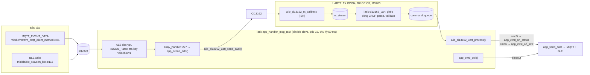
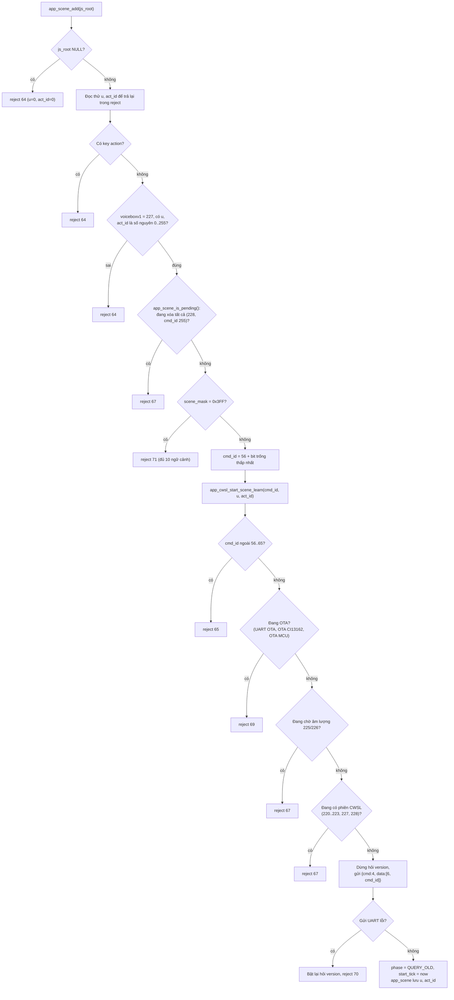
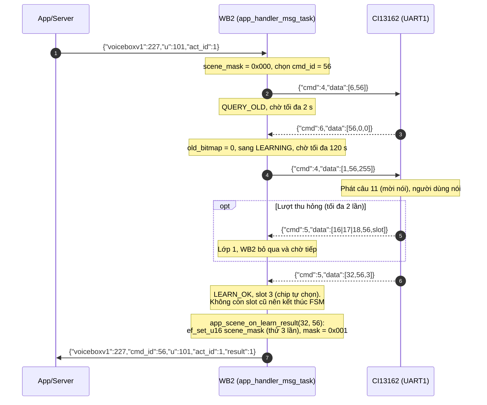
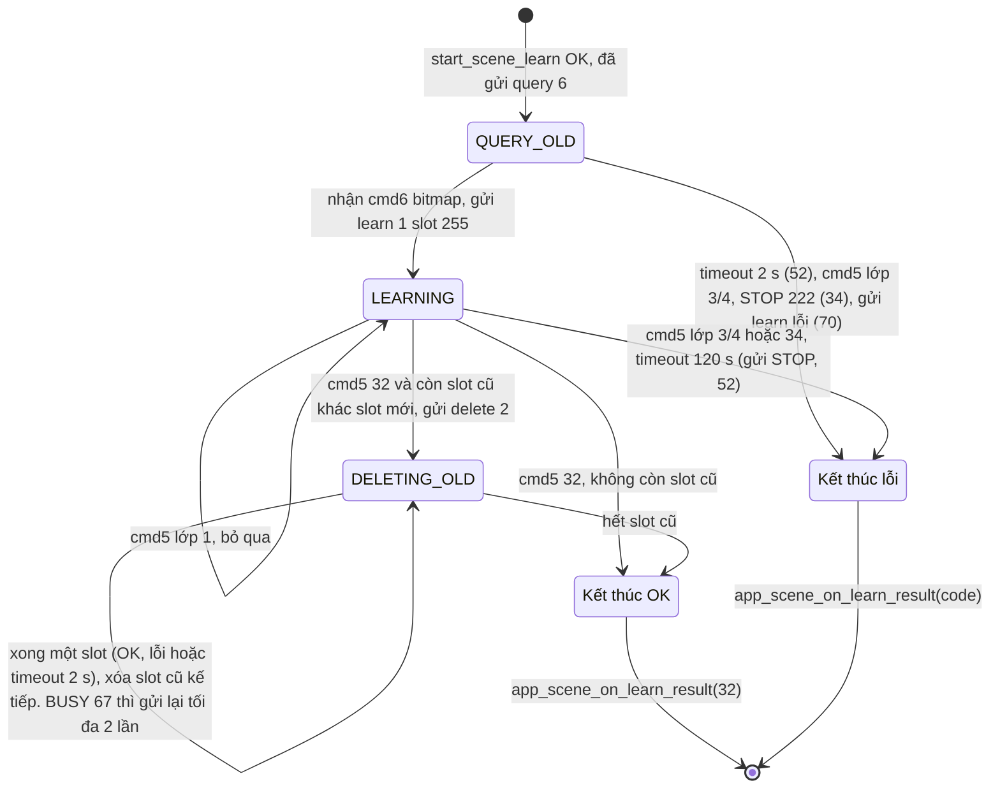
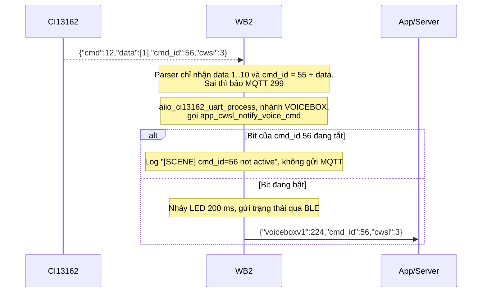

> Đây là luồng trước khi sửa (10 ngữ cảnh, không có value). Luồng hiện hành: luong_mqtt_227_them_ngu_canh_moi.md.

# Luồng chạy MQTT `voiceboxv1:227`: thêm ngữ cảnh bằng giọng nói

- Thiết bị: VOICEBOX (`device_type = VOICEBOX`, key JSON `"voiceboxv1"`).
- Code: branch `voiceboxv1/taodc/dev_261102`, working tree ngày 2026-11-02. Số dòng tính theo working tree này.
- Đường dẫn file viết gọn, gốc là `smarthome_devices/components/`.

## 1. Tóm tắt

| Mục | Giá trị |
|---|---|
| Request | `{"voiceboxv1":227,"u":<uid>,"act_id":<0..255>}`. Không có `action`, không có `cmd_id` |
| `cmd_id` | WB2 tự chọn: `56 + bit trống thấp nhất của scene_mask`, ra 56..65 (ngữ cảnh 1..10) |
| Các pha với chip | QUERY_OLD → LEARNING → DELETING_OLD. Pha cuối chỉ chạy khi chip còn mẫu cũ của `cmd_id` đó |
| Thành công | `{"voiceboxv1":227,"cmd_id":56,"u":101,"act_id":1,"result":1}`. Bật bit và lưu `scene_mask` vào EasyFlash |
| Thất bại | `{"voiceboxv1":227,"u":101,"act_id":1,"result":0,"code":<code>}` |
| Số bản tin trả về | Đúng một bản tin 227, không có ACK lúc bắt đầu. Nếu App gửi STOP 222 thì có thêm một bản tin 222 |
| Kênh trả về | `app_send_data()`: MQTT publish và BLE |
| Khi dùng ngữ cảnh | Chip gửi `cmd:12`. WB2 báo MQTT 224 nếu bit của ngữ cảnh đang bật |

## 2. Task và đường dữ liệu

- Toàn bộ FSM của 227 (`app_scene_*`, `app_cwsl_*`) chạy trong một task là `app_handler_msg_task` (`application/process_data.c:1437`), nên không cần khóa.
- Mỗi vòng lặp của task này làm theo thứ tự: xử lý bản tin từ chip, kiểm timeout, lấy một bản tin MQTT/BLE, rồi `vTaskDelay(50 ms)`.
- Bản tin từ chip đi qua ISR → `rx_stream` → task `ci13162_uart` → `command_queue`. Sau đó `aiio_ci13162_uart_process()` lấy ra trong `app_handler_msg_task`.
- Trên VOICEBOX, 227 không nằm trong danh sách lệnh bị bỏ qua (`application/process_data.c:1510`).

## 3. Kiểm tra request

Hai hàm thực hiện kiểm tra: `app_scene_add()` (`application/app_scene.c:186`) và `app_cwsl_start_scene_learn()` (`application/app_cwsl.c:938`).

- Bản tin reject có dạng `{"voiceboxv1":227,"u":<u>,"act_id":<act_id>,"result":0,"code":<code>}`.
- `u`, `act_id` và giá trị của key `voiceboxv1` phải là số nguyên không âm trong giới hạn (`app_scene_read_number`, `application/app_scene.c:52`).

## 4. Luồng thành công

Nếu bitmap ở bước 4 có slot cũ (chip còn mẫu của `cmd_id` 56 dù `scene_mask` không có bit đó), sau LEARN_OK WB2 sang DELETING_OLD và gửi `{"cmd":4,"data":[2,56,<slot_cũ>]}` cho từng slot cũ, rồi mới báo thành công.

## 5. FSM của 227 (`s_app_cwsl_mutating.phase`)

| Pha | Hàm xử lý | Timeout |
|---|---|---|
| QUERY_OLD | `app_cwsl_on_info()` `application/app_cwsl.c:631`. Riêng cmd5 rơi vào nhánh NORMAL của `app_cwsl_on_status()` (`app_cwsl.c:585`) | 2 s, `app_cwsl.c:1179` |
| LEARNING | `app_cwsl_on_status()` `app_cwsl.c:518` | 120 s, `app_cwsl.c:1194` |
| DELETING_OLD | `app_cwsl_on_status()` `app_cwsl.c:464` | 2 s mỗi slot, `app_cwsl.c:1216` |

- cmd5 hoặc cmd6 có `cmd_id` khác `cmd_id` đang học thì bị bỏ qua.
- Khi FSM kết thúc, `app_cwsl_clear_mutating()` (`app_cwsl.c:353`) bật lại việc hỏi version.
- Hằng timeout: `AIIO_CI13162_CWSL_QUERY_TIMEOUT_MS = 2000` và `AIIO_CI13162_CWSL_MUTATE_TIMEOUT_MS = 120000` (`hardware/aiio_ci13162_config.h:16-17`).
- Chip có timeout riêng là 30 s không tiến triển (`docs/voice/commands.md` mục 4.4), nên thường trả `0x34` trước khi WB2 hết 120 s.

## 6. STOP (MQTT 222) giữa chừng

Hàm xử lý: `app_cwsl_stop()` (`application/app_cwsl.c:1050`).

| Pha lúc nhận 222 | WB2 làm gì | Bản tin trả về |
|---|---|---|
| QUERY_OLD | Kết thúc ngay, không gửi UART | 227 `result:0, code:34`, và 222 `result:1, code:34` |
| LEARNING | Gửi `{"cmd":4,"data":[4]}`, chờ cmd5 | Khi chip trả: 227 `code:<code>`, và 222 `result:1` nếu code là 34, ngược lại `result:0`. Hết 120 s: 227 `code:52`, và 222 `result:0, code:52` |
| DELETING_OLD | Không dừng | 222 `result:0, code:67` |

## 7. Mã kết quả của 227

| code | Nguồn | Ý nghĩa |
|---:|---|---|
| (không có, `result:1`) | LEARN_OK và lưu flash OK | Thêm ngữ cảnh thành công, có `cmd_id` |
| 34 | STOP 222 | Người dùng dừng |
| 48, 49, 50, 52 | chip, cmd5 lớp 3 | Học hỏng, SDK abort, chip hết slot, chip timeout |
| 52 | WB2 | QUERY_OLD quá 2 s hoặc LEARNING quá 120 s |
| 64 | WB2 | Request sai: thiếu hoặc sai `u`, `act_id`, giá trị 227, hoặc có `action` |
| 64..68 | chip, cmd5 lớp 4 | Chip từ chối request |
| 65 | WB2 | `cmd_id` ngoài 56..65 (không xảy ra với cách chọn hiện tại) |
| 67 | WB2 | Bận: đang xóa tất cả ngữ cảnh, đang chờ âm lượng, hoặc đang có phiên CWSL khác |
| 69 | WB2 | Đang OTA |
| 70 | WB2 | Gửi UART lỗi, hoặc lưu `scene_mask` vào flash lỗi sau LEARN_OK |
| 71 | WB2 | Đã đủ 10 ngữ cảnh |

## 8. Khi người dùng nói câu ngữ cảnh (MQTT 224)

- `cwsl` là `255` khi nói câu gốc ("kích hoạt ngữ cảnh một"), và là `0..14` khi nói câu đã học.
- Trên VOICEBOX, WB2 không tự chạy ngữ cảnh mà chỉ báo 224 (`hardware/aiio_ci13162_uart.c:1903`).

## 9. Điểm cần chú ý khi sửa 227

Đây là quan sát từ code, chưa sửa.

1. Dải `cmd_id` của ngữ cảnh không khớp giữa các nguồn:
   - code dùng 56..65 (`application/app_scene.h:18-19`, parser `hardware/aiio_ci13162_uart.c:741`);
   - comment ở `application/app_scene.h:47-48` và `application/app_cwsl.h:85-96` ghi 58..67;
   - `CWSL_MQTT_SPEC.md` mục 2.4 ghi 46..55;
   - contract chip `docs/voice/commands.md` mục 2.1 có ngữ cảnh 1..15 (56..70). WB2 chỉ hỗ trợ 10; parser loại ngữ cảnh 11..15.
2. Không có ACK lúc bắt đầu. App chỉ nhận một bản tin 227 cuối, có thể sau hơn 120 s.
3. Nếu lưu `scene_mask` lỗi sau LEARN_OK, WB2 trả code 70. Mẫu vừa học vẫn nằm trên chip và không bị xóa. Vì bit tắt nên 224 bị chặn (`application/app_scene.c:246-257`).
4. Xóa slot cũ ở DELETING_OLD mà lỗi hoặc timeout thì vẫn báo thành công, nên slot cũ có thể còn trên chip (`application/app_cwsl.c:464-516`, `application/app_cwsl.c:1216-1254`).
5. 227 luôn tạo ngữ cảnh mới ở bit trống thấp nhất, không học lại được một ngữ cảnh cụ thể. Muốn đổi thì phải xóa bằng 228 rồi thêm lại bằng 227.
6. Lệnh LEARN chỉ gửi ba phần tử `[1,cmd_id,255]`, không có phần tử thứ tư `value` (câu trả lời) dù contract chip cho phép.
7. Pha QUERY_OLD dùng chung nhánh NORMAL trong `app_cwsl_on_status()`. Một cmd5 `32` cùng `cmd_id` đến trong pha này sẽ được tính là học thành công, dù WB2 chưa gửi LEARN.
8. FSM 227 trong `app_cwsl.c` chưa có host test. `test_app_scene_runner.c` mock `app_cwsl_start_scene_learn()` và gọi thẳng `app_scene_on_learn_result()`. `test_app_cwsl_runner.c` không có ca nào cho 227.

## 10. Bảng hàm

| Hàm | File:dòng | Vai trò |
|---|---|---|
| `app_handler_msg_task` | `application/process_data.c:1437` | Vòng lặp xử lý chính |
| `app_scene_add` | `application/app_scene.c:186` | Kiểm request, chọn `cmd_id` |
| `app_cwsl_start_scene_learn` | `application/app_cwsl.c:938` | Gửi QUERY, vào QUERY_OLD |
| `app_cwsl_on_info` | `application/app_cwsl.c:631` | Nhận bitmap, gửi LEARN |
| `app_cwsl_on_status` | `application/app_cwsl.c:450` | Xử lý LEARN_OK, lỗi, DELETING_OLD |
| `app_cwsl_poll` | `application/app_cwsl.c:1164` | Timeout |
| `app_cwsl_stop` | `application/app_cwsl.c:1050` | STOP 222 |
| `app_scene_on_learn_result` | `application/app_scene.c:246` | Lưu mask, gửi 227 |
| `aiio_ci13162_uart_send_cwsl` | `hardware/aiio_ci13162_uart.c:2183` | Tạo `{"cmd":4,...}` |
| `aiio_ci13162_uart_process` | `hardware/aiio_ci13162_uart.c:1823` | Lấy cmd5, cmd6, cmd12 từ queue |
| `app_cwsl_notify_voice_cmd` | `application/app_cwsl.c:1356` | Gửi 224 |
