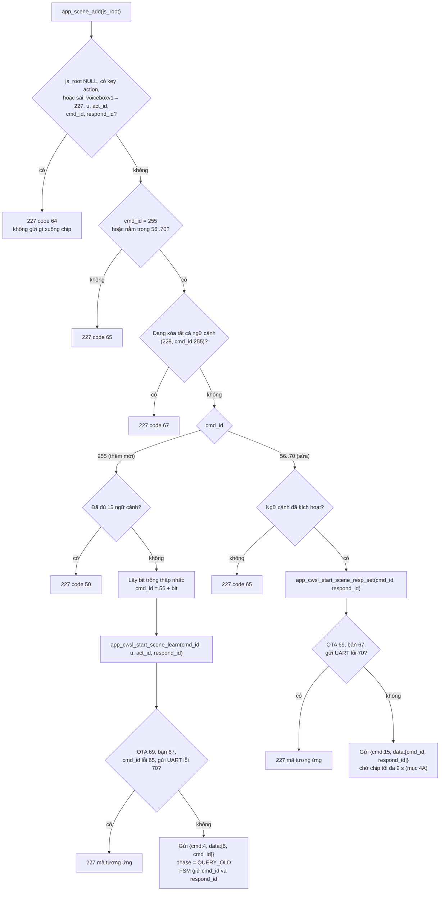
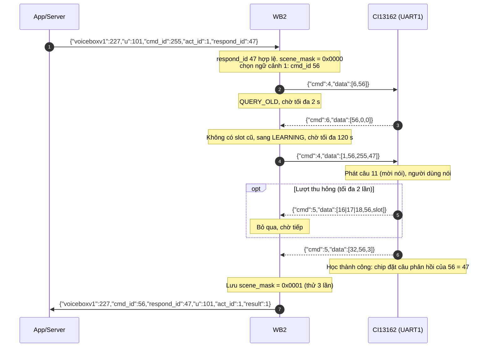
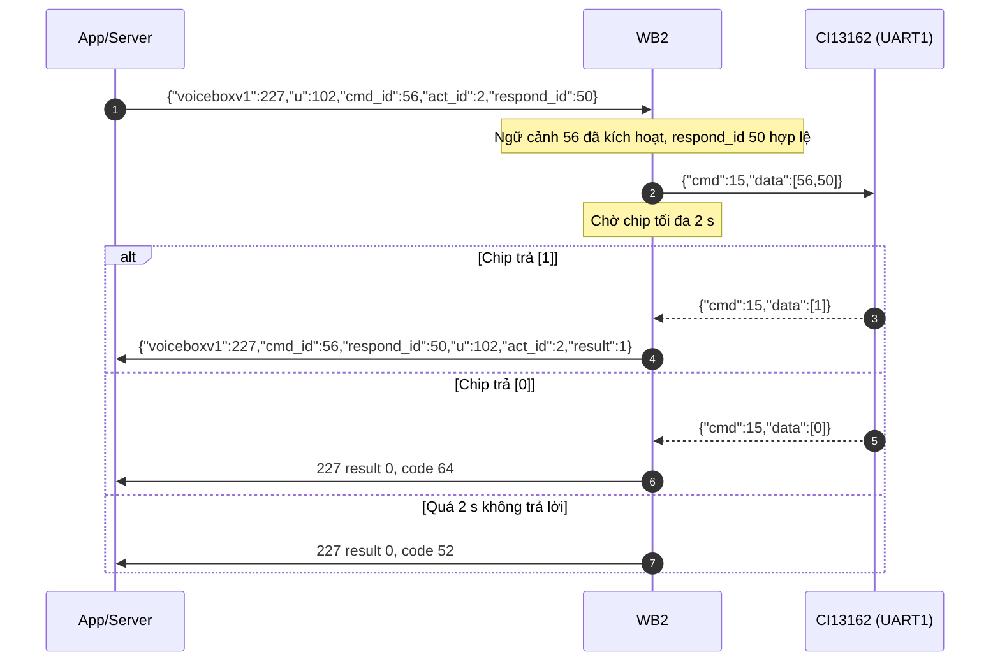
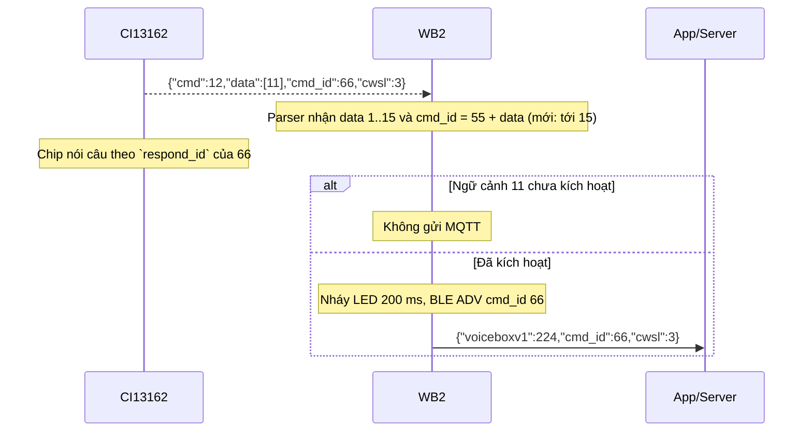

# Luồng chạy MQTT `voiceboxv1:227` sau khi sửa

- Trạng thái: **Đã code ngày 2026-11-02; phần `cmd_id`/`respond_id` đã code ngày 2026-11-03, chưa kiểm trên board.** Cập nhật 2026-11-03: format `cmd_id`/`respond_id`. Luồng cũ (trước khi sửa) xem `luong_mqtt_227_them_ngu_canh.md`.
- Nguồn yêu cầu:
  - `hnn_voiceboxv1.xlsx` sheet "Loa thông minh", mục 13, 14, 15, 16. Dải `cmd_id` 46..55 trong file này là thông tin cũ, không dùng.
  - `commands.md` mục 2.1 (ngữ cảnh 1..15 = `cmd_id` 56..70), mục 3.1 (response id) và mục 4 (CWSL).
  - Các câu người dùng trả lời ngày 2026-11-02.
- Chỗ đánh dấu **[tôi tự chọn]** là chỗ người dùng chưa nói; người dùng đã duyệt cả các chỗ này khi duyệt plan.

## 1. Thay đổi so với hiện tại

| Mục | Hiện tại | Sau khi sửa |
|---|---|---|
| Số ngữ cảnh tối đa | 10 (`cmd_id` 56..65) | **15 (`cmd_id` 56..70)** |
| `cmd_id` trong MQTT, UART, BLE ADV | 56..65 | 56..70. App, chip và BLE dùng cùng số, WB2 **không** đổi số |
| `scene_mask` trong flash | 10 bit (`0x03FF`) | **15 bit (`0x7FFF`)**. Bit 0..9 giữ nguyên, nên ngữ cảnh đã thêm vẫn còn |
| Request 227 | `{"voiceboxv1":227,"u","act_id"}` | `{"voiceboxv1":227,"u":..,"cmd_id":255\|56..70,"act_id":..,"respond_id":..}`. `cmd_id` và `respond_id` **bắt buộc**. Key `value` (bản nháp trước) bỏ, thay bằng `respond_id`; nếu App còn gửi thì bị bỏ qua như key lạ |
| `cmd_id` trong request 227 | Không có | 255 = thêm mới; 56..70 = sửa câu phản hồi của ngữ cảnh đã thêm |
| Response 227 | `{"…":227,"cmd_id","u","act_id","result"[,"code"]}` | Thêm `respond_id`: `{"…":227,"cmd_id":..,"respond_id":..,"u":..,"act_id":..,"result":1}`. Lỗi có thêm `"result":0,"code":..` |
| Lệnh học gửi chip | `[1,cmd_id,255]` | Luôn `[1,cmd_id,255,respond_id]` |
| Sửa câu phản hồi | Không có | Gửi `{"cmd":15,"data":[cmd_id,respond_id]}` (mục 4A) |
| 227 khi đã đủ ngữ cảnh | code 71 | **code 50** |
| 222 khi hủy thêm ngữ cảnh | `{"…":222,"u","act_id","result","code"}` | `{"…":222,"cmd_id","slot","code","u","act_id"}`, theo mục 14 |
| 228 với ngữ cảnh chưa kích hoạt | Vẫn gửi lệnh xóa xuống chip | Trả code **65**, không gửi chip |
| Parser UART `cmd:12` (ngữ cảnh) | `data` 1..10 | **`data` 1..15**, `cmd_id` = 55 + `data` |
| Parser UART `cmd:6` (trả lời QUERY) | `cmd_id` ≤ 65 | `cmd_id` ≤ 70 |
| 224 khi nói lệnh âm lượng | Có gửi | Không đổi (vẫn gửi) |

## 2. Dải ngữ cảnh

| Ngữ cảnh | `cmd_id` (MQTT, UART, BLE ADV) | UART `cmd:12` `data` | Bit `scene_mask` |
|---:|---:|---:|---:|
| 1 | 56 | 1 | 0 |
| 2 | 57 | 2 | 1 |
| … | … | … | … |
| 10 | 65 | 10 | 9 |
| 11 (mới) | 66 | 11 | 10 |
| … | … | … | … |
| 15 (mới) | 70 | 15 | 14 |

- `bit = cmd_id - 56`.
- Hai hằng `APP_SCENE_CMD_ID_MAX` (65 → 70) và `APP_SCENE_COUNT_MAX` (10 → 15) quyết định dải.
- Hai chỗ đang ghi cứng `0x03FF` trong `app_scene.c` sẽ tính theo `APP_SCENE_COUNT_MAX`.
- `APP_CWSL_CMD_ID_MAX` (65 → 70) là trần `cmd_id` chung cho 220..224 và parser `cmd:6`. Phải nâng trần này, nếu không thì chip trả lời cho 66..70 bị loại và 224 cho 66..70 không được gửi.

## 3. Kiểm tra request 227

`respond_id` hợp lệ: `0, 1, 2, 3, 11..19, 40..47, 50..68, 70, 71`.

0 = ngẫu nhiên, 1 = câu mặc định của lệnh (ngữ cảnh là câu 46), 2..99 = đúng câu đó (xem `commands.md` mục 3).

Thứ tự kiểm trong `app_scene_add`:
1. `js_root` NULL, có key `action`, hoặc `voiceboxv1`/`u`/`act_id`/`cmd_id`/`respond_id` sai → 64.
2. `cmd_id` khác 255 và ngoài 56..70 → 65.
3. Đang chờ xóa tất cả → 67.
4. Thêm mới (255): đủ ngữ cảnh → 50; nếu không thì bắt đầu học (có thể trả 65/67/69/70).
5. Sửa (56..70): ngữ cảnh chưa kích hoạt → 65; nếu không thì `app_cwsl_start_scene_resp_set` (có thể trả 67/69/70).

- `cmd_id` và `respond_id` sai kiểu (chuỗi, số thập phân, số âm, lớn hơn 255, `null`) hoặc thiếu đều trả code 64. `respond_id` là số nguyên 0..255 nhưng ngoài danh sách hợp lệ cũng trả 64.
- **[tôi tự chọn]** Thứ tự kiểm trên (kiểm request sai trước, rồi `cmd_id` ngoài dải, rồi bận/đầy) để request sai luôn nhận code 64 kể cả khi thiết bị đang bận.
- **[tôi tự chọn]** Cách ghi `cmd_id`/`respond_id` trong bản tin lỗi: số nguyên 0..255 đọc được thì ghi lại đúng số đó, kể cả khi không hợp lệ; thiếu hoặc sai kiểu thì ghi 0. Thêm mới bị lỗi trước lúc bắt đầu học thì `cmd_id` là 255; sau khi đã bắt đầu học thì là số đã cấp.

## 4. Luồng thành công (thêm mới, `respond_id` 47)

- Lệnh LEARN luôn có 4 phần tử, vì `respond_id` bắt buộc.
- Nếu chip vẫn từ chối `respond_id` (`{"cmd":5,"data":[64,56,255]}`), WB2 trả 227 code 64 và chip không học.
- Có slot cũ: sau LEARN_OK, WB2 xóa từng slot cũ bằng `{"cmd":4,"data":[2,56,<slot_cũ>]}`, rồi mới trả thành công. Phần này giữ như hiện tại.

## 4A. Sửa câu phản hồi (`cmd_id` 56..70)

Dùng cho ngữ cảnh đã thêm, chỉ đổi câu chip đáp. Không học lại giọng, không đổi `scene_mask`.

Mã lỗi của ca sửa:

| code | Khi nào |
|---:|---|
| 64 | Request sai (mục 3), hoặc chip trả `{"cmd":15,"data":[0]}` |
| 65 | `cmd_id` ngoài 56..70 (và khác 255), hoặc ngữ cảnh chưa kích hoạt |
| 67 | Bận: đang xóa tất cả, đang có phiên CWSL/âm lượng khác, đang chờ chip trả lời lệnh sửa trước, hoặc đang trong khoảng chờ bỏ frame muộn sau code 52 |
| 69 | Đang OTA |
| 52 | Chip không trả lời cmd 15 trong 2 s (`AIIO_CI13162_CWSL_QUERY_TIMEOUT_MS`) |
| 70 | Gửi UART lỗi |

- Sửa không đụng `scene_mask`.
- Trong lúc chờ chip trả lời lệnh sửa, 220/221/222/223/227/228 nhận code 67. 222 trả theo format reject cũ: `{"voiceboxv1":222,"u":..,"act_id":..,"result":0,"code":67}`. 225/226 bị chặn và trả theo format riêng của chúng với `result:0`, vì bản tin trả lời 225/226 không có trường `code`.
- Hết 2 s (code 52) nghĩa là chưa biết kết quả: chip có thể đã áp. Sau 52, WB2 chờ thêm tối đa 2 s để bỏ frame trả lời muộn; lệnh sửa gửi trong khoảng này nhận 67. Frame muộn đến thì kết thúc khoảng chờ sớm. App có thể gửi lại sau đó. Khoảng chờ này không chặn thêm mới, xóa, hỏi hay âm lượng.
- **[tôi tự chọn]** Bản tin version query (cmd 3) tạm dừng trong lúc chờ lệnh sửa.
- **[tôi tự chọn]** `cmd:15` từ chip đến khi không có lệnh sửa nào đang chờ (ví dụ đến muộn sau timeout) bị bỏ qua, không có bản tin 227 thứ hai.
- Parser UART chỉ nhận `cmd:15` có đúng một giá trị 0 hoặc 1, không có `cmd_id`/`cwsl`; chuyển cho `app_cwsl_on_resp_set()`.

## 5. FSM

Giữ nguyên ba pha QUERY_OLD → LEARNING → DELETING_OLD và các timeout (2 s / 120 s / 2 s mỗi slot), như mục 5 của `luong_mqtt_227_them_ngu_canh.md`.

Chỉ đổi:
- FSM giữ thêm `respond_id` để gửi trong lệnh LEARN khi chuyển từ QUERY_OLD sang LEARNING.
- Ca sửa (mục 4A) không dùng ba pha này: chỉ có một trạng thái chờ cmd 15, timeout 2 s.
- Bản tin 222 khi kết thúc phiên đã hủy dùng format mới (mục 6).

## 6. Hủy bằng 222 (theo mục 14)

| Pha lúc nhận 222 | WB2 làm gì | Bản tin trả về |
|---|---|---|
| QUERY_OLD | Kết thúc ngay, không gửi UART | 227 `result:0, code:34`, và `{"voiceboxv1":222,"cmd_id":56,"slot":255,"code":34,"u":..,"act_id":..}` |
| LEARNING | Gửi `{"cmd":4,"data":[4]}`, chờ cmd5 | Chip trả `[34,56,slot]`: 227 `code:34`, và 222 `cmd_id:56, slot:<slot>, code:34`. Chip trả mã lỗi khác: cả 227 và 222 mang mã đó |
| LEARNING, hết 120 s sau khi gửi STOP | Kết thúc | 227 `code:52`, và 222 `cmd_id:56, slot:255, code:52` |
| Đang chờ chip trả lời lệnh sửa (cmd 15) | Không dừng, không gửi STOP | `{"voiceboxv1":222,"u":..,"act_id":..,"result":0,"code":67}` (không phải 68) |
| DELETING_OLD | Không dừng | `{"voiceboxv1":222,"u":..,"act_id":..,"result":0,"code":67}` (giữ format reject cũ) |

**[tôi tự chọn]**
- Khi hủy lúc chip chưa trả slot, `slot` là 255.
- Bản tin 227 kết thúc (`code:34`, …) vẫn gửi như hiện tại.
- Các reject của 222 (67, 68, 69, 70) giữ format cũ có `result:0`, vì mục 14 chỉ mô tả trường hợp hủy được.

## 7. Mã kết quả của 227 sau khi sửa

| code | Nguồn | Ý nghĩa |
|---:|---|---|
| (`result:1`) | WB2 | Thành công, kèm `cmd_id` 56..70 và `respond_id` |
| 34 | STOP 222 | Người dùng hủy |
| 48, 49, 52 | chip, cmd5 lớp 3 | Học hỏng, SDK abort, chip timeout |
| **50** | WB2 hoặc chip | **WB2: đã đủ 15 ngữ cảnh (mới).** Chip: hết bộ nhớ học (15 slot dùng chung). App nhận cùng một code cho hai trường hợp |
| 52 | WB2 | QUERY_OLD quá 2 s, LEARNING quá 120 s, hoặc **sửa: chip không trả lời cmd 15 trong 2 s** |
| 64 | WB2 | Request sai: `cmd_id`/`respond_id`/`u`/`act_id` thiếu hoặc sai, `respond_id` ngoài danh sách. **Sửa: chip trả `cmd:15` `[0]`** |
| 65 | WB2 | `cmd_id` ngoài dải; **sửa: ngữ cảnh chưa kích hoạt** |
| 64..68 | chip, cmd5 lớp 4 | Chip từ chối |
| 67 | WB2 | Bận (kể cả đang chờ chip trả lời lệnh sửa, hoặc đang trong khoảng chờ 2 s bỏ frame muộn sau code 52 của lệnh sửa) |
| 69 | WB2 | Đang OTA |
| 70 | WB2 | Gửi UART lỗi (kể cả cmd 15), hoặc lưu `scene_mask` lỗi |
| ~~71~~ | — | Bỏ, thay bằng 50 |

Lưu ý: chip chỉ có 15 slot học dùng chung cho mọi lệnh (`commands.md` mục 4.1). Khi đã có 15 ngữ cảnh, mỗi ngữ cảnh chiếm một slot, nên chip hết chỗ học cho lệnh khác. Học lại wake (`cmd_id` 1) không bị ảnh hưởng vì dùng 5 slot riêng.

## 8. Khi người dùng nói câu ngữ cảnh

- Lệnh âm lượng (48..55) giữ như hiện tại: vẫn gửi 224 và 225.
- `cmd:12` với `data` 16 trở lên, hoặc lệnh nhà 71..103, vẫn bị parser loại (MQTT 299) như hiện tại.

## 9. 228 và 229 sau khi sửa

**228 (xóa ngữ cảnh)**
- Request: `{"voiceboxv1":228,"cmd_id":56..70 hoặc 255,"u":..,"act_id":..}`.
- Trả code 65 (không gửi xuống chip) khi:
  - `cmd_id` ngoài 56..70 và khác 255;
  - ngữ cảnh chưa kích hoạt **(mới)**, theo mục 15.
- Xóa một ngữ cảnh: gửi `{"cmd":4,"data":[2,<cmd_id>,255]}`. Thành công thì trả `{"voiceboxv1":228,"cmd_id":56,"u":..,"act_id":..,"result":1}`.
- `cmd_id` 255: xóa lần lượt 56..70 như hiện tại (tối đa 15 lệnh xóa), trả một bản tin `cmd_id:255`.

**229 (danh sách)**
- Trả `{"voiceboxv1":229,"scenes":[56,57],"total":2,"u":..,"act_id":..,"result":1}`.
- 15 ngữ cảnh vẫn vừa buffer hiện tại.

## 10. Tác động phụ

- MQTT 220/221 với `cmd_id` 66..70: hiện trả code 65 (vượt trần). Sau khi sửa, các id này nằm trong dải ngữ cảnh nên trả code **64**, giống 56..65 hiện nay (ngữ cảnh phải đi qua 227/228).
- MQTT 223 trên VOICEBOX vẫn chỉ nhận `cmd_id` 1 hoặc 255. Không đổi.

## 11. Không làm trong plan này

- 220/221/223: VOICEBOX vẫn chỉ cho `cmd_id` 1.
- Lệnh nhà 71..103.
- Firmware chip.
- Đọc câu phản hồi hiện tại (`CMD_RESP_GET`, cmd 16) và chọn giọng (cmd 17/18).
- Học lại giọng khi sửa.

Các điểm sau từ mục 9 của `luong_mqtt_227_them_ngu_canh.md` vẫn còn:
- Không có ACK lúc bắt đầu 227.
- Lưu `scene_mask` lỗi sau LEARN_OK (code 70) thì mẫu vừa học vẫn còn trên chip.
- Xóa slot cũ lỗi hoặc timeout vẫn báo thành công.
- cmd5 `32` đến trong pha QUERY_OLD được tính là học thành công.
- Chip trả `32` đúng lúc vừa nhận STOP: 227 báo thành công nhưng **không có** bản tin 222 trả lời người hủy.
- Mẫu "mồ côi" (chip còn mẫu nhưng bit trong `scene_mask` là 0, ví dụ sau khi lưu flash lỗi): 228 với `cmd_id` đó trả 65 nên không xóa được riêng. Lần 227 sau cấp lại `cmd_id` đó sẽ dọn mẫu ở pha xóa slot cũ. Nếu 15 slot học của chip đã đầy thì lần học đó trả 50, và chỉ còn cách xóa bằng 228 `cmd_id` 255.

## 12. Test đã thêm hoặc sửa

- `test_app_scene_runner.c`:
  - đủ 15 ngữ cảnh thì trả 50;
  - ngữ cảnh thứ 11 nhận `cmd_id` 66;
  - xóa tất cả chạy 56..70;
  - 228 với ngữ cảnh chưa kích hoạt trả 65;
  - `respond_id` hợp lệ và không hợp lệ (sai kiểu, ngoài danh sách, thiếu) trả 64;
  - App cũ không gửi `cmd_id` hoặc chỉ gửi `value` trả 64;
  - sửa: ngữ cảnh chưa kích hoạt trả 65, đang xóa tất cả trả 67;
  - thứ tự kiểm: 64 trước 65, 65 trước 67, 67 trước kiểm chưa kích hoạt; sửa lần hai gửi lỗi vẫn giữ lệnh sửa đang chờ;
  - mask cũ 10 bit vẫn đọc đúng.
- `test_app_cwsl_runner.c`:
  - FSM 227 gửi `[6,56]`, rồi `[1,56,255,47]`;
  - sửa: gửi `{"cmd":15,"data":[56,50]}`, chip trả `[1]` → thành công, `[0]` → 64, 2 s → 52, `cmd:15` đến muộn bị bỏ; sau 52 lệnh sửa mới nhận 67 trong 2 s (frame muộn kết thúc sớm), học vẫn nhận;
  - 220/221/222/223/227/228 nhận 67 và 225/226 bị chặn khi đang chờ lệnh sửa;
  - 222 hủy ở QUERY_OLD và ở LEARNING trả đúng format mục 14;
  - 224 cho `cmd_id` 66..70.
- `test_uart_protocol_runner.c`:
  - `aiio_ci13162_uart_send_cwsl` tạo được frame 4 phần tử;
  - `aiio_ci13162_uart_send_resp_set` tạo frame `cmd:15`; parser nhận `cmd:15` `[0]`/`[1]`, loại dạng khác;
  - parser nhận `cmd:12` `data` 15 (`cmd_id` 70), loại `data` 16;
  - nhận `cmd:6` với `cmd_id` 70.
